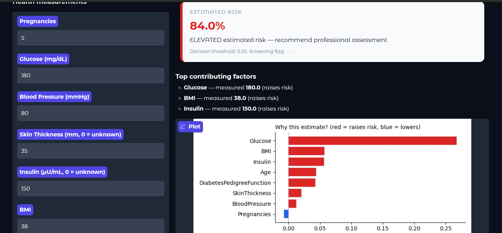

# HealthSignal AI
**Intelligent Insights for Earlier Health Awareness**

An AI-powered diabetes risk-screening prototype for community health workers.
Built for the **Veritas AI International High School Hackathon 2026** — AI + Health track.

## What it does
Community health workers enter routine measurements (glucose, BMI, blood pressure, age, etc.). The model returns an **estimated diabetes risk probability**, an **explanation of which features drove the prediction** (SHAP), and **clear guidance to seek professional assessment** when risk is elevated.

## 🚀 Try it live
**[Launch HealthSignal AI on HuggingFace Spaces] git clone https://huggingface.co/spaces/robelm/healthsignal-ai**

No installation needed. Runs in your browser.

> ⚠️ **This project is a prototype and is not medical advice.**
> It does not diagnose diabetes and does not replace a clinician.

## How it works
- **Dataset:** Pima Indians Diabetes (UCI / Kaggle, 768 samples, 8 features).
- **Preprocessing:** Physiologically impossible zeros treated as missing; median imputation inside a sklearn Pipeline to prevent leakage.
- **Models compared:** Majority-class baseline, Logistic Regression, Random Forest.
- **Chosen model:** Random Forest (300 trees).
- **Explainability:** SHAP TreeExplainer, per-prediction.
- **Decision threshold:** 0.30 (not 0.5) — prioritizes recall for screening.

## Evaluation (held-out test set, 154 samples)
| Model | Acc | Prec | Rec | F1 | AUC | FN | FP |
|---|---|---|---|---|---|---|---|
| Baseline (majority) | 0.649 | 0.000 | 0.000 | 0.000 | 0.500 | 54 | 0 |
| Logistic Regression | 0.708 | 0.600 | 0.500 | 0.545 | 0.813 | 27 | 18 |
| Random Forest (thr=0.50) | 0.740 | 0.659 | 0.537 | 0.592 | 0.816 | 25 | 15 |
| **Random Forest (thr=0.30)** | **0.708** | **0.560** | **0.778** | **0.651** | — | **12** | **33** |

## Limitations
- Trained only on **women of Pima Indigenous descent aged ≥21**. Not validated for other populations.
- Data collected in the **1990s**.
- **Insulin and Skin Thickness are ~30–49% missing** — SHAP contributions from these are unreliable.
- At threshold 0.30 the model still misses **≈22% of positive cases**.
- **This is a screening-awareness prototype, not a diagnostic tool.**

## Files
- `app.py` — Gradio web interface
- `healthsignal_rf.pkl` — trained model
* `training_and_evaluation.ipynb` — full training notebook
- `REPORT.md` — evaluation report
- `writeup.md` — one-page summary

## Citations
- Dataset: Smith et al. (1988), *Using the ADAP learning algorithm to forecast the onset of diabetes mellitus.*
- SHAP: Lundberg & Lee (2017), NeurIPS.
- Libraries: scikit-learn, pandas, NumPy, Gradio, matplotlib.

## Disclaimer
**This project is a prototype and is not medical advice.**
